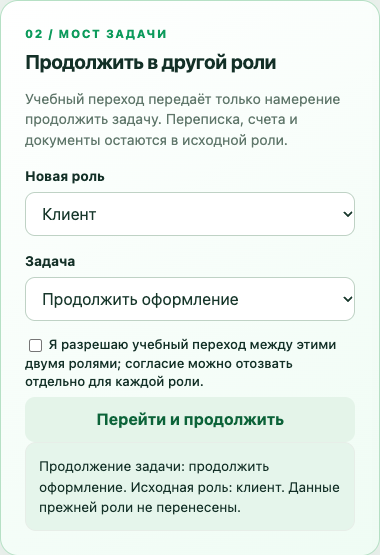
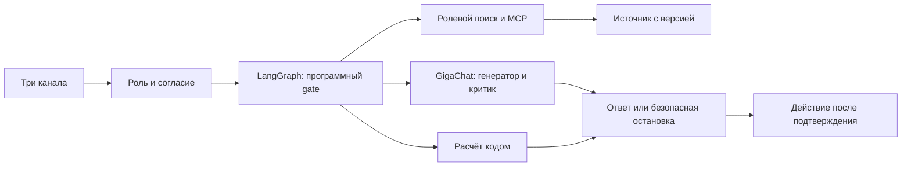

# Контур — универсальный помощник для трёх ролей

> Один человек приходит в банк как клиент, предприниматель или сотрудник. Задача должна продолжаться, а права и данные каждой роли — оставаться под контролем.

**[Открыть сайт](https://sber.dimaystinov.duckdns.org/) · [Анимированная презентация](https://sber.dimaystinov.duckdns.org/deck/) · [PDF для жюри](output/pdf/universal-assistant-case-2026.pdf) · [Архитектура](docs/PROJECT-ARCHITECTURE.md)**

«Контур» — работающий учебный продукт по кейсу Сбера для AI for Business Cup 2026. В репозитории есть браузерное приложение, API, GigaChat harness, ролевой MCP, симуляторы банковских сервисов, воспроизводимые проверки и презентация. Его можно запустить и пройти сквозной сценарий. **Реальные сервисы Сбера и данные клиентов не подключены**: для них нужны доступ к песочнице, согласованные права и проверенные источники.



## Кейс за минуту

Клиент начинает оформление, затем переходит в СберБизнес. Обычно ему приходится повторять задачу. Наш продукт передаёт в новую роль **одноразовый сигнал о намерении продолжить оформление**. Бизнес-помощник открывает следующий шаг из своего разрешённого учебного источника. Переписка, счёт, выписки и память клиентской роли не переходят вместе с ним.

| Роль | Что можно сделать в демо | Где проходит граница |
|---|---|---|
| **Клиент** | Узнать учебный остаток, подобрать товар, подготовить корзину или бронь | Факты берутся из разрешённого источника; реальный баланс не выдумывается |
| **Предприниматель** | Продолжить оформление, изучить учебные данные бизнеса, посчитать кассовый разрыв, подготовить рекламное действие или платёжный черновик | Числа проверяет код; изменение требует подтверждения |
| **Сотрудник** | Найти учебную инструкцию, просмотреть задачи и подготовить назначение | HR-контур изолирован; действующий внутренний регламент без источника не подменяется примером |

Сквозной путь **клиент → согласие → предприниматель → ответ из нового источника** пройден в браузере. Его кадры включены в [презентацию](output/pdf/universal-assistant-case-2026.pdf). Разрешение на переход можно отозвать: ожидающий токен перестанет действовать, а собственный контекст каждой роли сохранится.

## Как устроен Контур



**Общее ядро управляет процессом; знания, сессии и инструменты разделены.** Модель не получает свободный доступ к инструментам. Сервер проверяет роль, согласие и источник до вызова модели, а источник и числовые утверждения — перед выдачей ответа. Ролевой MCP работает с учебными данными; учебные действия используют `prepare → подтверждение → confirm`. Для расчёта кассового разрыва применяется `Decimal`.

[Подробная архитектура и карта компонентов →](docs/PROJECT-ARCHITECTURE.md) · [Правовая граница трёх контуров →](docs/THREE-CONTOUR-LEGAL-ARCHITECTURE.md) · [Harness и выбор моделей →](docs/HARNESS-RESEARCH-AND-DESIGN.md)

## Что уже проверено

- **107 автоматических тестов** прошли 11 ноября 2026 года: API, согласия, запреты межролевого доступа, MCP, расчёты и учебные действия.
- **3 600 эпизодов**: по 1 200 на каждую роль, 23 основных шаблона. Ещё **3 600 эпизодов** прошли расширенную матрицу из 50 шаблонов. Это синтетические повторы с детерминированной заглушкой модели; они проверяют заданные инварианты, а не банковскую надёжность.
- В малом тесте поиска по 10 учебным документам лексический поиск дал **10/10** для точных запросов и **0/10** для перефразировок; GigaChat-3-Lightning выбрал разрешённый документ в **10/10** перефразировках. Объём теста недостаточен для оценки качества на реальных данных.
- Онлайн-проба GigaChat-3-Pro обнаружила непроверенную формулу, пропущенную критиком. После этого числовые выводы получили отдельный программный gate и регрессионный тест.

[Научная статья и методика →](docs/SCIENTIFIC-ARTICLE-AI-AGENTS.md) · [Результаты и график →](docs/figures/research-results.png) · [Экономика 2027–2029 с допущениями →](docs/ECONOMICS-ROADMAP-2027-2029.md)

## Запустить за несколько минут

Требуется Python 3.12+; команды ниже рассчитаны на macOS/Linux. Без `GIGACHAT_CREDENTIALS` продукт использует offline-заглушку и учебные данные. На Windows см. [отдельную инструкцию](START_WINDOWS.md).

```bash
git clone https://github.com/dimaystinov/sber-assistant.git
cd sber-assistant
python3 -m venv .venv
.venv/bin/python -m pip install -r requirements.txt
.venv/bin/python -c 'import secrets; from pathlib import Path; Path(".env").write_text("ASSISTANT_ENV=demo\nASSISTANT_DEMO_TOKEN=" + secrets.token_urlsafe(24) + "\n")'
.venv/bin/python -m uvicorn assistant.api:app --env-file .env --host 127.0.0.1 --port 8000
```

Откройте **http://127.0.0.1:8000/** и введите `ASSISTANT_DEMO_TOKEN` из локального `.env`. Выберите роль клиента, затем блок «Продолжить в другой роли». Учебное согласие и переход откроют вопрос в бизнес-роли. Для онлайн-режима добавьте свои `GIGACHAT_CREDENTIALS` и `GIGACHAT_SCOPE` в `.env`; секреты не коммитятся. Не вводите реальные банковские или персональные данные в публичную демонстрацию.

Проверка кода:

```bash
.venv/bin/python -m pytest -q
.venv/bin/python -m presentation.build_case_pdf
```

Публичный сайт — **витрина и презентация**, а не размещённый банковский backend. Интерактивное приложение запускается локально по инструкции выше. [Как опубликован сайт →](docs/SITE-DEPLOYMENT.md)

## Карта проекта

| Где | Что находится |
|---|---|
| [`assistant/`](assistant/) | FastAPI, три роли, LangGraph, GigaChat, ролевой MCP, инструменты и симуляторы |
| [`tests/`](tests/) | Проверки доступа, источников, вычислений и действий |
| [`evals/`](evals/) | Синтетические сценарии и воспроизводимые результаты |
| [`docs/`](docs/) | Архитектура, право, исследования, экономика, спич |
| [`presentation/`](presentation/) | Анимированная версия и сборщик итогового PDF |
| [`site/`](site/) | Публичная статическая страница GitHub Pages |

## Материалы для выступления

- [Исходное задание Сбера, версия 3](docs/source/AI-for-Business-Cup-2026-Sber-case-v3.pdf) и [сверка с шестью требованиями](docs/CASE-REQUIREMENTS-AUDIT.md).
- [Итоговая презентация, 15 слайдов](output/pdf/universal-assistant-case-2026.pdf), [спич к ней](docs/CASE-2026-PITCH.md) и [анимированная версия](presentation/animated.html).
- [Исследование GigaGraph, critic-подхода и LangExtract](docs/GIGAGRAPH-IMPROVEMENTS.md), [сравнение моделей и harness](docs/HARNESS-RESEARCH-AND-DESIGN.md).
- [Симуляция Sber API MCP](docs/SBER-MCP-SIMULATION.md) и [план подключения официальной песочницы](docs/SBER-OFFICIAL-SANDBOX.md).
- [Публичные правила и регламенты](docs/PUBLIC-POLICIES-RESEARCH.md), [правовые источники РФ](docs/RU-LEGAL-SOURCES-AND-GATE.md), [учебный контур сотрудника](docs/EMPLOYEE-POLICY-SIMULATION.md).

## Граница готовности

Продукт **готов к локальному показу и воспроизведению исследований**. Для пилота в Сбере ещё нужны: подтверждённые идентичности и полномочия трёх ролей, утверждённая матрица передаваемых фактов, реальные согласия, банковский broker и аудит, доступ к песочнице Sber API, внутренние документы с владельцем и сроком действия, проверка ИБ и юристами, а затем оценка пользы на разрешённых сценариях с контрольной группой. [План этих шагов →](docs/PRODUCT-STRATEGY-AND-DEMO.md)

Разработка ориентируется на [Google Python Style Guide](https://google.github.io/styleguide/pyguide.html) и [Google Engineering Practices](https://google.github.io/eng-practices/). Проект независимый, не является официальным сервисом ПАО Сбербанк.
