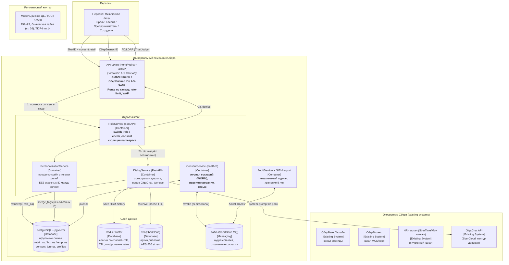

# C4-диаграмма «Универсальный помощник Сбера» — контейнерный уровень (C4:2)

## Диаграмма (Mermaid, нотация C4-Container через flowchart)

## Элементы уровня C4:2

| # | Container | Технология | Ключевая обязанность | Критерий изоляции |
|---|-----------|-----------|----------------------|-------------------|
| 1 | **GW** API-шлюз | Kong + FastAPI | Идентификация канала, WAF, rate-limit, маршрутизация по роли | Спорит роль по домену канала: `*.sberbank.ru`→retail, `business.sber.ru`→biz, HR-домен→emp |
| 2 | **RC** RoleService | FastAPI | switch_role, check_consent, выдача «переключательного» токена | Разные namespace; отказ до обращения к LLM |
| 3 | **CHAT** DialogService | FastAPI + GigaChat SDK | Retrieval-augmented диалог, tool-use для банковских операций | Prompt LLM получает ТОЛЬКО данные активного namespace |
| 4 | **CONS** ConsentService | FastAPI | CRUD согласий, версионирование, отзыв, журнал WORM | Отдельная схема `consent_journal` (append-only) |
| 5 | **PERS** PersonalizationService | FastAPI | Профиль-центр, теги `{retail, biz, emp}`, холодный/тёплый контекст | Требует ≥2 активных consents для «сквозных» фич; без дешифруемого cross-ID |
| 6 | **AUD** AuditService | Python + Kafka | Незаменимый журнал всех обращений к данным | Хранит actor_hash, namespace, действие — вне hands of DialogService |

## Ключевые архитектурные решения (ADR-выжимка)

1. **ADR-01. Namespace-per-role, не «одна общая БД с FK».**
   Схемы `retail_ns`, `biz_ns`, `emp_ns` в PostgreSQL — отдельные pgvector-индексы (HNSW), отдельные политики RLS. Присоединение (JOIN) между схемами запрещено правами `ROLE assistant_retail` / `assistant_biz` / `assistant_emp` на уровне СУБД.

2. **ADR-02. Сквозная идентификация отсутствует by-design.**
   Вместо единого `user_id` используется детерминированный **`subject_hash(role)`** = `HMAC-SHA256(master_key, sber_id || role_salt)` — уникальный hash в каждой схеме. Обратное преобразование (re-identification) технически невозможно без мастер-ключа, который держит отдельная Key Management Service (KMS) сбера и который доступен только ConsentService для особых случаев (суд/росфинмониторинг), с записью факта в audit.

3. **ADR-03. Согласие — первоклассная сущность (не флаг).**
   Согласие версионируется, имеет scope (текст, empty-input/hard-refusal), дату, канал получения, юридический документ (`docs/consent_retail_v3.pdf`). Отзыв через Kafka-топик `consent.revoked` гарантирует распространение за ≤5 минут по всем сервисам.

4. **ADR-04. Три роли — до трёх независимых LLM-сессий.**
   История диалогов хранится по ключу `session_ns:role:hash`, при переключении роли создаётся **новая** сессия, а не продолжается. При явном запросе «учти мой бизнес-контекст» — retrieval из другого namespace возможен только при активном согласии обоих ролей (`opt-in cross-retrieval`).

5. **ADR-05. GigaChat — приватный контур (SberCloud GigaChat API, не публичный).**
   Все тексты, включая PII, не выходят за доверенный контур (TrustAlias/protected cloud). Системный промпт инжектирует текущую роль и запрет «переходить» в другую роль.
