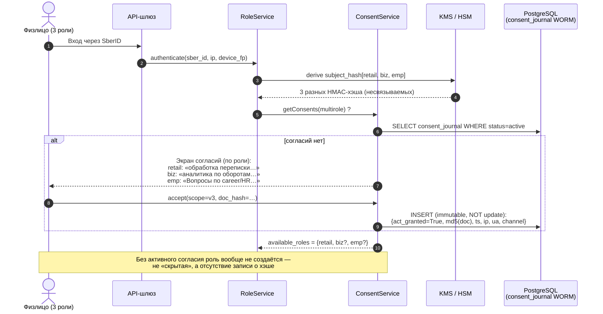
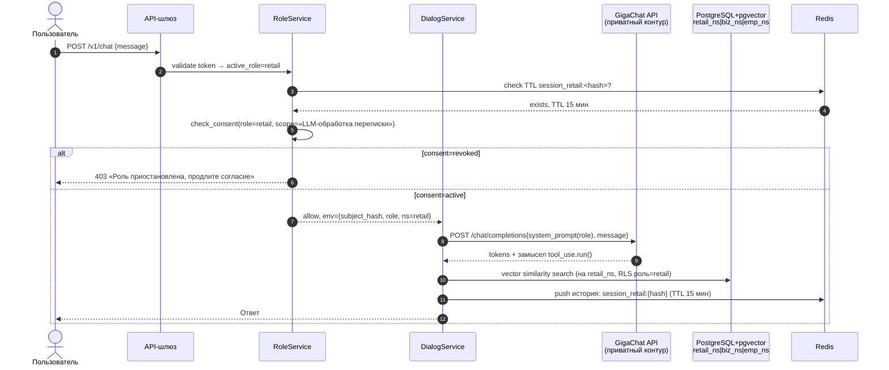
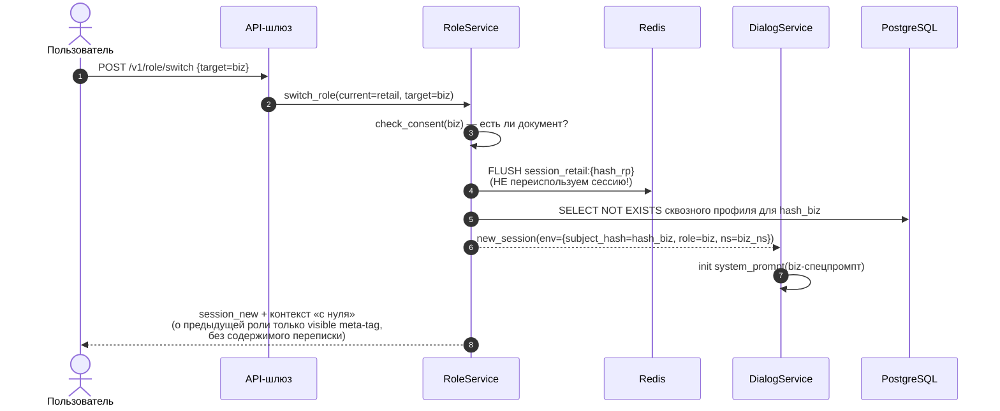
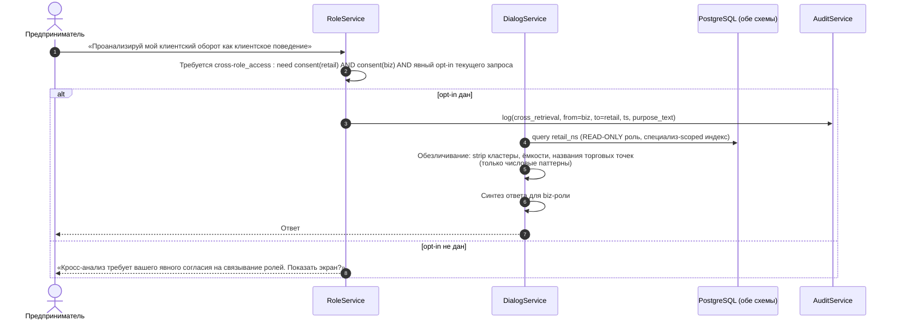
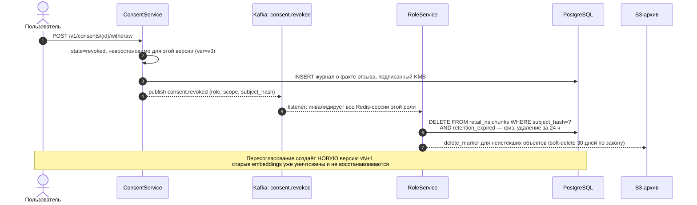

# Схема потоков данных с учётом согласий

## 1. Поток «Первый вход + выдача согласий» (onboarding)

## 2. Поток «Обычный диалог внутри одной роли»

## 3. Поток «Переключение роли» (самый критичный)

**Ключевое правило:** переключение роли = открытие **нового** диалога. Прошлый контекст недоступен напрямую; пользователь должен явно попросить «учти мой клиентский контекст».

## 4. Поток «Сквозной контекст через согласие» (opt-in cross-retrieval)

## 5. Поток «Отзыв согласия» (уничтожение контекста)

## 6. Сводная таблица потоков → обязательств

| Поток | 152-ФЗ | Банковская тайна (ст.26 ФЗ-395-1) | ТК РФ (гл.14) | Механизм в архитектуре |
|---|---|---|---|---|
| 1 — Онбординг | ч.1 ст.9 (согласие до обработки) | — | ст.86–90 | ConsentService с WORM-журналом, версии документов |
| 2 — Диалог | ст.10.1 (обезлич. для автоматизации) | п.3 (кто имеет доступ) | ст.88 (доступ ограничен) | RLS по схемам, изоляция pgvector |
| 3 — Смена роли | ст.18.5 (персонализация по согласию) | — | — | Новая сессия, отсутствие сквозного ID |
| 4 — Cross-retrieve | ч.2 ст.9 (конкретные цели) | тайна операций (ст.26 п.1) | — | Двойное согласие + opt-in + обезличивание |
| 5 — Отзыв | ч.2 ст.9 (право отзыва) | — | ст.89 (право на сохранение в порядке) | Асинхронное уничтожение ≤24 ч, асимметричное удаление |
