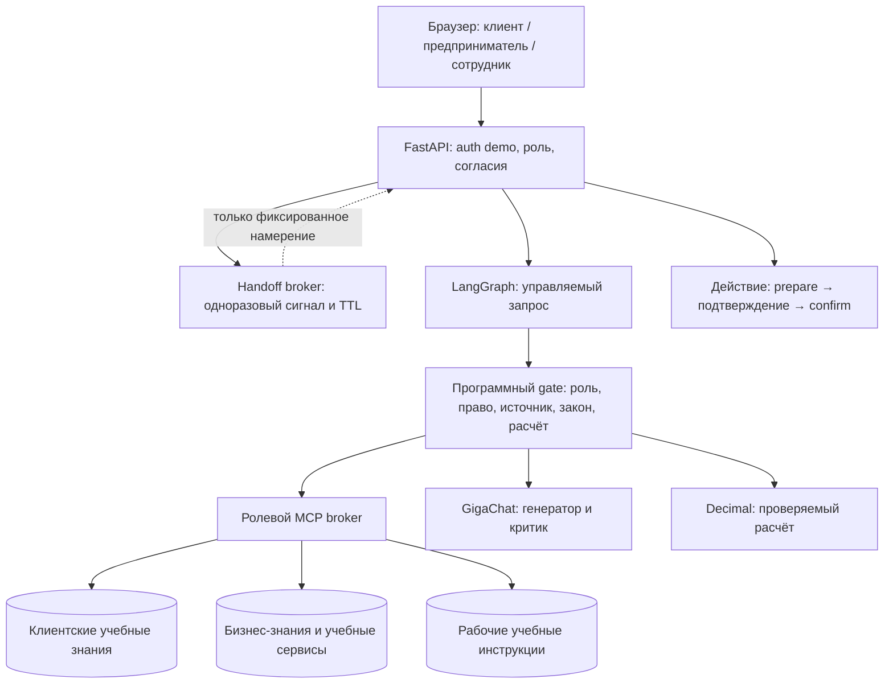

# Архитектура проекта

**Работающий учебный продукт и исходный код:** [github.com/dimaystinov/sber-assistant](https://github.com/dimaystinov/sber-assistant). Репозиторий содержит FastAPI-приложение, браузерный интерфейс, ролевой MCP, симуляторы сервисов, тесты, исследование и презентацию. Продукт готов к локальному запуску и показу. Подключение к банковской песочнице и промышленный запуск требуют доступа, которого у команды пока нет.

## Схема системы

`API` и граф общие как **код управления**, а данные и полномочия разделены по ролям. Из клиентского или бизнес-контура нельзя напрямую читать память, документы или инструменты сотрудника. Ролевой MCP-сервер создаётся с доверенно установленной ролью; модель не выбирает роль в аргументах инструмента.

## Путь запроса

1. `assistant/api.py` проверяет локальный демо-токен, активную роль и канал. Это учебная аутентификация одного субъекта; она не заменяет Sber ID или служебный вход.
2. `assistant/role_context.py` и `assistant/consent.py` проверяют согласие на обработку и изолируют сессию и память роли. `assistant/context_store.py` хранит их в памяти процесса.
3. `assistant/chat_graph.py` ищет только разрешённые документы через `assistant/mcp_tools.py`. `assistant/knowledge.py` выдаёт учебные источники с ID, версией и происхождением; broker повторно проверяет роль и версию ответа MCP.
4. Программный gate до генерации останавливает запросы без нужного источника, вопросы о действующем внутреннем регламенте и юридические советы без проверенной нормы. Расчёт кассового разрыва выполняет `assistant/calculations.py` с `Decimal`.
5. Там, где ответ допустим, `assistant/gigachat.py` вызывает модель Сбера и критика. Проверка ссылок на источники и числовых утверждений остаётся в коде графа. Критик повышает шанс найти ошибку, но не служит гарантией точности.
6. Учебные изменения (`assistant/demo_tools.py`, `assistant/simulated_sber_services.py`) идут через `prepare → подтверждение человека → confirm`. Модель не имеет прямого права менять состояние. Реальные банковские системы не изменяются.

## Переход между клиентом и предпринимателем

`assistant/handoff.py` передаёт только одно из фиксированных намерений через одноразовый токен на 120 секунд. Выдача и погашение требуют согласия обеих ролей; отзыв разрешения закрывает новый и ожидающий переход. История, текст запроса, выписки, эмбеддинги и идентификаторы исходной роли не передаются. Отзыв согласия на **переход** сохраняет собственную память каждой роли; отзыв согласия на **LLM-обработку** удаляет сессию и учебный контекст соответствующей роли. Сотрудническая роль не участвует в этом мосте.

## Что работает, что симулируется

| Компонент | Сейчас | Для банковского пилота |
|---|---|---|
| Интерфейс и API | Работающий локальный продукт, три роли и переход | Адаптеры трёх каналов, реальная идентификация |
| Модель | GigaChat при наличии ключа; offline-заглушка для воспроизведения | Согласованные модели, SLA и оценка на разрешённых кейсах |
| Знания | Версионированные учебные документы по ролям | Утверждённые регламенты с владельцем, доступом и сроком действия |
| MCP и инструменты | Настоящий in-process MCP и симуляторы Sber API | Сервисные учётные записи, mTLS, доступ к песочнице и аудит |
| Хранение и согласия | In-memory изоляция и журнал для одного демо-субъекта | Защищённое хранилище, реестр согласий, KMS, сроки удаления |
| Действия | Учебные черновики с подтверждением | Согласованные API и права на каждое действие |

## Где смотреть в репозитории

- Запуск и ключевые ограничения: [`README.md`](../README.md).
- Реальный путь в браузере: [`assistant/static/index.html`](../assistant/static/index.html), [`docs/PRODUCT-STRATEGY-AND-DEMO.md`](PRODUCT-STRATEGY-AND-DEMO.md).
- API, граф и переход: [`assistant/api.py`](../assistant/api.py), [`assistant/chat_graph.py`](../assistant/chat_graph.py), [`assistant/handoff.py`](../assistant/handoff.py).
- Правовая граница трёх контуров: [`docs/THREE-CONTOUR-LEGAL-ARCHITECTURE.md`](THREE-CONTOUR-LEGAL-ARCHITECTURE.md).
- Проверка: [`tests/`](../tests/), [`evals/`](../evals/). Параметризованные учебные эпизоды подтверждают только заданные инварианты симуляции.
- Готовый слайдовый пакет: [`output/pdf/universal-assistant-case-2026.pdf`](../output/pdf/universal-assistant-case-2026.pdf), [`presentation/animated.html`](../presentation/animated.html).
