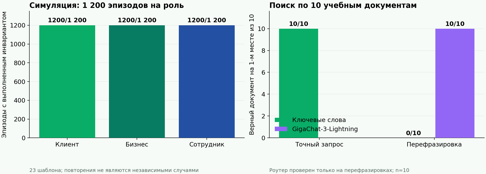

# От языковой модели к проверяемому действию: архитектура и симуляционная оценка трёхролевого банковского ИИ-ассистента на GigaChat

**Исследовательский прототип; версия 10 ноября 2026 года.** Работа не описывает внедрение в инфраструктуру ПАО Сбербанк и не содержит результатов работы с реальными клиентами или сотрудниками. Внутренние документы, счета, CRM и HR-системы заменены учебными данными. Наблюдаемые результаты относятся к локальной симуляции и ограниченной онлайн-пробе GigaChat.

## Аннотация

Рассмотрен агентный ассистент для трёх ролей одного человека: клиента, предпринимателя и сотрудника банка. Целью является не только ответ, но и проверяемое полезное действие: запись, добавление товара в корзину, анализ рекламы или создание задачи. Предложен harness на LangGraph и GigaChat с изоляцией ролей, версионированными знаниями, серверным broker инструментов, независимым GigaChat-критиком, программной проверкой расчётов и подтверждением изменяющих операций. Воспроизводимая симуляция содержит 3 600 параметризованных эпизодов, по 1 200 на роль, построенных из 23 шаблонов; все заданные инварианты прошли. На учебном корпусе из 10 документов лексический поиск дал hit@1 10/10 для точных запросов и 0/10 для перефразировок; семантический выбор источника GigaChat-3-Lightning дал 10/10 на тех же перефразировках. Шесть онлайн-вопросов к GigaChat-3-Pro обнаружили ошибку класса «непроверенная формула в бизнес-совете», после чего введён программный gate и регрессионный тест. Ни одна из этих оценок не доказывает эффективность или безопасность реального банковского внедрения. В статье предложен протокол причинной полевой оценки.

**Ключевые слова:** GigaChat, банковский ассистент, агентный harness, LangGraph, RAG, MCP, tool use, симуляция, безопасность, human-in-the-loop.

## 1. Постановка задачи и научный контекст

Модель способна сформулировать убедительный ответ, но полезность рабочего ассистента определяется ещё доступом к правильным данным, корректным расчётом, полномочием выполнить действие и фактическим состоянием системы после него. В исследовании контакт-центра с 5 179 агентами генеративная помощь повысила число решённых вопросов в час в среднем на 14%, но эффект был неоднородным: около 34% для новичков и низкоквалифицированных сотрудников [1]. У 758 консультантов результат зависел от того, находилась ли задача внутри «неровной границы» возможностей модели [2]. В рандомизированном эксперименте с 640 предпринимателями средний эффект ИИ-советника не отличался от нуля, а общие рекомендации снизить цену или увеличить рекламу могли вредить части пользователей [3]. Следовательно, нельзя переносить средний эффект одной профессии на банк или обещать предпринимателю пользу от гладкого, но неподтверждённого совета.

Объект исследования — **система «модель + контекст + инструменты + правила + проверка»**, а не модель отдельно. Исследовательские вопросы: (RQ1) выдерживают ли три роли механические границы доступа и подтверждения в симуляции; (RQ2) как малый ролевой поиск реагирует на перефразировку; (RQ3) какие дефекты выявляет онлайн-проба генератора с независимым критиком; (RQ4) как подключить MCP, не передав модели полномочия напрямую. Гипотезы об ускорении сотрудников и коммерческом эффекте **не проверялись**.

## 2. Система и границы доверия

### 2.1. Три роли

| Роль | Типовой результат | Недопустимая подмена |
|---|---|---|
| Клиент | Узнать статус учебного счёта, подготовить бронь или корзину | Выдумать остаток, тариф или совершить покупку без подтверждения |
| Предприниматель | Сравнить конкурентов, проверить экономику рекламы и бюджета | Выдать гипотетические проценты за измеренный ROI или запустить кампанию без согласия |
| Сотрудник | Найти процедуру, подготовить задачу, проверить статус | Выдать учебный документ за действующий внутренний регламент Сбера |

Роль и полномочия устанавливаются сервером; модель не может изменить их текстом запроса. История сессий изолирована. Сквозной контекст допускается только как проверенный агрегат с отдельным согласием; учебный флаг происхождения пока не является промышленным механизмом доверия. Для внутренних процедур и правовых вопросов отсутствие утверждённого источника ведёт к отказу или передаче специалисту. Это соответствует принципу, что найденный документ не является системной инструкцией.

### 2.2. Harness и модели Сбера

Оркестрация реализована на исходном LangGraph и `langchain-gigachat`. Авторы [GigaGraph](https://github.com/ai-forever/gigagraph) помечают свой форк устаревшим и рекомендуют эту комбинацию. В текущем графе GigaChat-3-Pro формирует ответ, отдельный вызов той же модели с чистым контекстом оценивает черновик; при отказе или ошибке критика черновик скрывается. Независимость контекста уменьшает общую ошибку памяти, но одинаковая модель может разделять слепые зоны; критик не считается доказательством истинности. Идея внешней проверки архитектуры с «памятью золотой рыбки» соотносится с [Elephant Goldfish Model](https://github.com/google/elephant-goldfish-model), однако в runtime она ограничена отдельным критическим узлом.

Перед генерацией выполняются маршруты роли, источника, юридического вопроса и живых данных. После генерации программный gate блокирует определённый класс непроверенных денежных формул и процентов. Структурный расчёт кассового разрыва делает код на `Decimal`. Regex-gate не доказывает корректность всей арифметики: для реального продукта каждый тип расчёта должен иметь типизированный инструмент с единицами измерения и тестами. Этот выбор прямо следует из наблюдения в онлайн-пробе (§4.3).

### 2.3. Знания и RAG

У каждой роли отдельный учебный корпус. Документ содержит `source_id`, версию, срок действия, происхождение и роль. Доступ проверяется **до** поиска, а выбранный ID — по allowlist **после** выбора моделью. Первоначальный лексический поиск над малым корпусом прост и воспроизводим, но уязвим к перефразировке (§4.2). Для большего корпуса предлагается гибридный поиск (полнотекстовый + семантический), затем проверка версии, достаточности фрагмента и поддержки каждого существенного утверждения. Оригинальная работа по RAG показывает пользу привязки генерации к внешней памяти [4], однако исследование корректности цитирования показывает, что наличие верной цитаты не обязательно означает, что она обосновывает конкретное утверждение [5]. [LangExtract](https://github.com/google/langextract) можно исследовать для извлечения фрагментов с привязкой к месту в документе; готовой проверенной интеграции с GigaChat в прототипе нет.

Попытка оценить Sber `EmbeddingsGigaR` с доступным ключом вернула HTTP 402; векторное качество **не измерено**. Семантический выбор GigaChat на 10 документах не следует называть масштабируемым векторным RAG. Реальные документы должны поступать от владельца процесса с утверждением, редакцией и правами. Для права первичны [официальный портал правовой информации](https://pravo.gov.ru/) и [акты Банка России](https://www.cbr.ru/banking_sector/acts/); коммерческие справочные базы требуют отдельного права на использование в RAG. Публичные документы Сбера не заменяют внутренние регламенты.

### 2.4. Инструменты и MCP

Текущий прототип использует внутренний серверный broker с учебными действиями. **После первичной симуляции** добавлен настоящий in-process MCP-клиент/сервер для ролевого поиска, чтения учебных данных (остаток, каталог, бизнес-показатели, задачи) и детерминированного расчёта кассового разрыва. Сервер создаётся для доверенно установленной роли и не публикует `confirm` или платёжные инструменты; broker проверяет роль и согласие до вызова, а источник и ответ после него. Новый путь проверен отдельными тестами, HTTP-интеграцией и повторным прогоном 3 600 учебных эпизодов в конфигурации MCP. Из них 1 734 диалоговых эпизода проходят MCP-поиск; действия и атаки проверяют прежний broker. Это нагрузка на повторяемые шаблоны, а не измерение эксплуатационной надёжности. Внешние корпоративные MCP и реальные банковские данные не подключены. План, контракты и приоритеты находятся в [MCP-INTEGRATION-PLAN.md](MCP-INTEGRATION-PLAN.md). На следующем этапе полезны read-only CRM/счёт, затем инструменты корзины, брони, рекламного черновика и задач с разделением `prepare`/`confirm`. Официальный [Sber docs-mcp](https://developers.sber.ru/docs/ru/gigachat/guides/using-docs-with-llm) полезен разработчику, [MCP Voice Salute](https://github.com/ai-forever/gigachain) — для голосового интерфейса, [MCP Kandinsky](https://github.com/ai-forever/gigachain) — для креативов; они не являются источниками банковской истины. [Пример Sber GigaChain](https://github.com/ai-forever/gigachain/blob/master/cookbook/mcp/agent.py) демонстрирует подключение GigaChat к MCP через адаптер LangChain, но банковский контур требует отдельного broker, фильтра функций и проверки TLS.

### 2.5. Сравнение с открытыми внедрениями GigaChat

Публичная [заявка Сбера на GlobalCIO](https://globalcio.ru/projectoftheyear/list/54211/) фиксировала 26 агентов и 18 областей знаний на 30 октября 2025 года; в [сообщении Сбера от 3 ноября 2026 года](https://www.sberbank.com/ru/news-and-media/press-releases/article?blockID=7&lang=ru&newsID=e4b64368-1b13-4ebc-ba01-6ed936efb652&regionID=77&type=NEWS) названы уже 176 агентов и более 650 тысяч пользователей в месяц. Это продуктовые заявления разных дат, не результаты независимого измерения нашего проекта. [Презентация к заявке](https://globalcio.ru/upload/iblock/c59/eacf5m3vw0x31qn2pzj0bu520q5ds1d5/Proekt-goda-2025_-Giga_assistent.pdf) показывает переход от анализа к плану и частичному исполнению в трёх сценариях: торги, открытие точки и интернет-магазин. Кейс [«Азимута»](https://sberbs.ru/blogs/cases/keys-azimut-kak-aviakompaniya-vnedrila-ii-assistenta-kotorogo-ne-zapugat-slozhnymi-zaprosami) иллюстрирует GigaChat+RAG для первой линии поддержки, а [«Тулпар»](https://sberbs.ru/blogs/cases/vnedrenie-ii-assistenta-na-baze-gigachat-v-gruppe-kompaniy-tulpar) — сочетание FAQ и генеративной базы внутренних документов. Подробное сравнение функций, результатов и ограничений источников — в [SBER-GIGACHAT-BUSINESS-CASES.md](SBER-GIGACHAT-BUSINESS-CASES.md).

Для каждого вызова broker проверяет идентичность, роль, scope, согласие, схему аргументов, владельца объекта, лимиты и идемпотентность. Результат инструмента считается недоверенным текстом. Изменяющее действие показывается человеку с точным payload; подтверждение одноразовое, связано с субъектом и payload и проверяется на сервере. Это согласуется с [моделью authorization MCP](https://modelcontextprotocol.io/specification/2025-11-25/basic/authorization) и [OWASP MCP Security Cheat Sheet](https://cheatsheetseries.owasp.org/cheatsheets/MCP_Security_Cheat_Sheet.html). Критик отвечает за смысловую проверку, но не заменяет серверные права. Результат операции сверяется с состоянием, а не с красивым текстом модели.

## 3. Методика исследования

### 3.1. Симуляция

Сценарии описывают исходное состояние, роль, запрос, действие и проверяемый итог. Генератор создаёт 1 200 эпизодов на роль с seed `20261109`, всего 3 600 эпизодов из **23 разных шаблонов**. Вариации включают новый субъект/сессию, значения чисел, бюджетов и названия; повторяющаяся структура остаётся общей. Семейства: диалог (1 734), действие (794), атака/отказ (1 072). Для каждого эпизода состояние создаётся заново. Тот же набор запущен в двух конфигурациях: прямой учебный broker и in-process MCP broker. Проверяются коды маршрутов, запрет чужой роли и неверного токена, подтверждение/повтор, отзыв согласия и другие реализованные инварианты. Детерминированная заглушка модели позволяет воспроизводить именно harness, а не частоту ошибок генерации. Дизайн напоминает задачу проверки конечного состояния в [τ-bench](https://arxiv.org/abs/2406.12045); атаки мотивированы [AgentDojo](https://arxiv.org/abs/2406.13352), но наш набор существенно меньше обоих бенчмарков.

### 3.2. Поиск знаний

Вручную размечены 20 запросов к 10 учебным документам: 10 точных и 10 перефразированных. Метрика `hit@1` равна доле случаев, где первый разрешённый документ совпал с заранее заданным `gold_source_id`. Сравниваются текущий лексический путь и GigaChat-3-Lightning как выбор одного ID из отфильтрованного ролевого списка. Такая постановка измеряет только маршрутизацию источника; она не измеряет ответ, достаточность доказательства, отказ на неизвестном вопросе или поиск в большом корпусе.

### 3.3. Онлайн-проба ответа

Шесть синтетических запросов выполнены на GigaChat-3-Pro в пути генератор → критик. Сохранены решения, задержка и расход токенов. В одном бизнес-ответе до изменения кода обнаружена непроверенная формула ROI, хотя критик пропустил ответ. Затем добавлены программный gate и тест на этот класс ошибки; онлайн-проба повторена как проверка работоспособности, **не** как рандомизированное сравнение. Разница между двумя стохастическими прогонами не может приписываться изменению без парного контроля.

## 4. Результаты



| Измерение | Результат | Корректная интерпретация |
|---|---:|---|
| Симуляция, клиент | 1 200/1 200 | Заданные механические инварианты пройдены на повторениях шаблонов |
| Симуляция, предприниматель | 1 200/1 200 | То же; не доказана экономическая выгода совета |
| Симуляция, сотрудник | 1 200/1 200 | То же; реальные внутренние регламенты не использовались |
| Повтор в конфигурации MCP | 3 600/3 600 | Механические проверки повторены; 1 734 диалога использовали MCP-поиск |
| Расширенная матрица сервисов | 3 600/3 600 | По 1 200 эпизодов на роль, 50 параметризованных шаблонов; 5 публичных категорий Sber API MCP и 5 учебных адаптеров |
| Лексический поиск, точная формулировка | 10/10 hit@1 | Малый учебный корпус |
| Лексический поиск, перефразировка | 0/10 hit@1 | Явный дефект покрытия формулировок |
| GigaChat-3-Lightning, перефразировка | 10/10 hit@1 | Выбор ID из 10 разрешённых документов, без теста OOD |
| Онлайн-проба до gate | 6 ответов из 6 | Один обнаруженный пример непроверенной формулы, пропущенный критиком |
| Онлайн-проба после gate | 5 ответов, 1 `needs_review` | Система отвечает и эскалирует; причинный эффект gate этим не установлен |

После завершения исходного исследования создана дополнительная [симуляция сервисов](SBER-MCP-SIMULATION.md). Она использует опубликованные имена tools и scopes пяти [официальных Sber API MCP-сервисов](https://developers.sber.ru/docs/ru/sber-api/mcp/mcp-payment): платежи, сведения о клиенте, выписки, инкассация и депозиты/НСО. CRM, HR, ИТ, регламенты и идентичность имеют явно вымышленные контракты. Учебный платежный tool создаёт лишь неподписанный черновик `CREATED` после отдельного подтверждения; не имитирует подпись и исполнение. Новый массив из 50 шаблонов запущен по 1 200 раз на роль, все проверки прошли. Он также использует локальные MCP-двойники и заглушку языковой модели; реальные серверы Сбера не вызывались.

Результаты 3 600/3 600 в обоих массивах нельзя превращать в «ошибка <0,03%» или «надёжность 100%»: эпизоды зависимы, наборы ограничены 23 и 50 шаблонами, а модель в масштабных прогонах заменена заглушкой. Малый RAG-бенчмарк подобран вручную, так что 10/10 не является оценкой генеральной совокупности. В повторной онлайн-пробе отказ критика не доказывает действие нового gate; доказательство блокировки конкретной непроверенной формулы — детерминированный регрессионный тест. Полные машинные результаты: [`large-deployment-simulation.json`](../evals/results/large-deployment-simulation.json), [`large-deployment-simulation-mcp.json`](../evals/results/large-deployment-simulation-mcp.json), [`service-matrix.json`](../evals/results/service-matrix.json), [`rag-benchmark.json`](../evals/results/rag-benchmark.json), [`guarded-probe.jsonl`](../evals/results/guarded-probe.jsonl).

## 5. Обсуждение: полезность, риски и внедрение

Механическая защита даёт измеримую границу: модель не выбирает роль, не подтверждает собственное действие и не назначает себе доступ к документу. Однако безопасность не исчерпывается допуском к инструменту. Ошибочный совет может быть вреден и без действия; критик одной семьи моделей способен ошибаться согласованно с генератором. Поэтому для регулируемой консультации требуется проверяемый источник, расчёт кодом и компетентный человек. [Политика допустимого использования ИИ Сбера](https://developers.sber.ru/docs/ru/policies/gigachat-agreement/permissible-use-ai) учитывается как публичная рамка; её применимость к конкретному корпоративному сценарию требует договорной и юридической проверки.

Задачи стоит делить по цене ошибки. Низкий риск: поиск документа с цитатой или подготовка черновика. Средний: анализ рекламы с явными допущениями, расчёт, подготовка корзины. Высокий: перевод денег, кредитное решение, публикация кампании, HR-решение, юридический вывод. Для последних нужны отдельный уровень авторизации и контроль специалиста; в текущем прототипе реальное выполнение отсутствует. Полезность измеряется не числом сгенерированных токенов, а завершением задачи, временем, качеством результата и числом исправлений.

## 6. Протокол будущего полевого исследования

Для утверждения «агенты улучшают реальную работу» нужен закрытый пилот с разрешёнными данными и собственниками процессов. До запуска фиксируются целевые задачи и первичные метрики отдельно для трёх ролей: доля завершённых без исправления задач, время до результата, критические ошибки на 1 000 задач, доля эскалаций, удовлетворённость и экономический эффект с учётом затрат. Сравнение — текущий рабочий процесс против ассистента с теми же правами и данными; рандомизацию можно провести по сотрудникам или очередям с учётом кластерного переноса. Эксперты вслепую оценивают факты, соответствие редакции регламента, корректность расчёта и законность действия. Для задач с действием проверяется конечное состояние. Многошаговую устойчивость оценивают повторными прогонами `pass^k`; безопасность — заранее утверждёнными атаками на права, prompt injection и повторный вызов. Критические нарушения задают правила остановки пилота. Отчёт публикует неопределённость и разрезы по ролям, а не только средний эффект.

Перед таким пилотом необходимы SberID/корпоративная идентичность, реальные scopes, утверждённые источники, журнал версий и аудита, тестирование отказов MCP, управление ПДн, отдельная проверка договорных условий API и юридическая экспертиза. Прототип не закрывает эти требования. Подробная матрица гипотез и план абляций находятся в [`workspace/experiment-designs/banking-agents/three-role-harness`](../workspace/experiment-designs/banking-agents/three-role-harness/experiment_design.md).

## 7. Заключение

Научный результат этого этапа — воспроизводимый пример того, как соединить GigaChat, ролевые знания, инструменты и программные границы в один проверяемый harness; симуляция обнаруживает регрессии, а малая онлайн-проба обнаружила конкретный дефект, который критик не остановил. Результат не подтверждает безошибочность модели и не доказывает выигрыш от внедрения. Следующий содержательный шаг — расширить независимые механизмы сценариев, оценить поиск на разрешённом корпусе с неизвестными вопросами и провести контролируемый пилот с реальными метриками работы.

## Воспроизводимость

Из корня проекта после установки зависимостей:

```bash
.venv/bin/python -m pytest -q
.venv/bin/python -m evals.simulate_deployment --per-role 1200 --seed 20261109 --output evals/results/large-deployment-simulation.json
.venv/bin/python -m evals.simulate_deployment --per-role 1200 --seed 20261109 --mcp --output evals/results/large-deployment-simulation-mcp.json
.venv/bin/python -m evals.simulate_service_matrix --per-role 1200 --seed 20261110 --output evals/results/service-matrix.json
.venv/bin/python -m evals.evaluate_rag --semantic-router
.venv/bin/python -m evals.plot_research_results
```

Последние две онлайн-пробы требуют личного доступа к GigaChat API и расходуют токены; закрытый ключ в репозиторий не включён. Результат Sber embeddings с этим ключом — HTTP 402. Симуляция не требует доступа к банку.

## Литература

1. Brynjolfsson E., Li D., Raymond L. *Generative AI at Work*. NBER Working Paper 31161, 2023. https://www.nber.org/papers/w31161
2. Dell’Acqua F. et al. *Navigating the Jagged Technological Frontier*, 2023. https://aiinstitute.hbs.edu/navigating-the-jagged-technological-frontier/
3. Otis N. et al. *The Uneven Impact of Generative AI on Entrepreneurial Performance*. Management Science, 2024. https://doi.org/10.1287/mnsc.2024.06909
4. Lewis P. et al. *Retrieval-Augmented Generation for Knowledge-Intensive NLP Tasks*, 2020. https://arxiv.org/abs/2005.11401
5. *Correctness is not Faithfulness in RAG Attributions*, 2024. https://arxiv.org/abs/2412.18004
6. Yao S. et al. *τ-bench: A Benchmark for Tool-Agent-User Interaction*, 2024. https://arxiv.org/abs/2406.12045
7. Debenedetti E. et al. *AgentDojo: A Dynamic Environment to Evaluate Prompt Injection Attacks and Defenses for LLM Agents*, 2024. https://arxiv.org/abs/2406.13352
8. Sber AI. GigaChain, GigaGraph, GigaChat API and MCP documentation. https://github.com/ai-forever/gigachain ; https://github.com/ai-forever/gigagraph ; https://developers.sber.ru/help/gigachat-api/model-context-protocol
